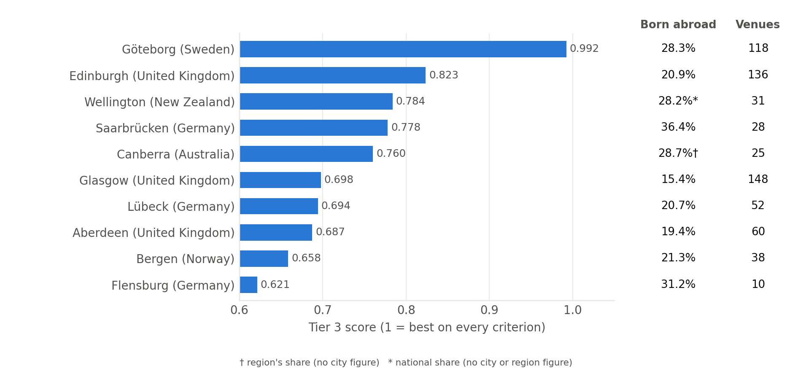

<p align="center">
  
</p>

<p align="center">
  <a href="https://github.com/VihaanJois/HIMCM-26-27/graphs/contributors"></a>
</p>

<p align="center">
  
  
</p>

## Overview

HIMCM (the High School Mathematical Contest in Modeling) is a math modeling competition in which a team of four works together to solve one problem. This year, our team of Teja, Vihaan, Aarit and August tackled the question of **where the best place to live is**. We took a unique approach: instead of scoring every city in the world at once, our model narrows the world down in three rounds, like a tournament.

- **Three-tier funnel:** countries → regions → cities
- **Data-driven weights:** the entropy method lets the data decide how much each criterion counts
- **No double counting:** every criterion is used in exactly one tier
- **Tested for robustness:** equal weights, leave-one-out and missing-data checks

## How the model works

| Tier | Ranks | Criteria | Passes on |
|---|---|---|---|
| 1 | Countries (World Bank) | Healthcare, water, sanitation, internet, road safety, test scores, income equality | Top 30 countries |
| 2 | OECD regions inside those countries | Homicide, vehicle theft, air quality (PM2.5), green space, public transport access | Top 20 regions |
| 3 | OECD cities inside those regions | Demographic diversity (% born abroad), entertainment (venues within 5 km) | Top 10 cities |

Every tier scores places the same way:

1. **Cap outliers:** each indicator is capped at its 5th and 95th percentiles, so one extreme place cannot distort the scale.
2. **Rescale:** each indicator is scaled from 0 to 1, where 1 is best.
3. **Weight:** the entropy method gives more weight to indicators that separate places more.
4. **Score:** each place's score is the weighted average of the indicators it has data for.

## Results

| | Tier 1: countries | Tier 2: regions | Tier 3: cities |
|---|---|---|---|
| **#1** | Singapore | Australian Capital Territory | Göteborg, Sweden |
| **Charts** | [`results/fig_tier1`](results/fig_tier1) | [`results/fig_tier2`](results/fig_tier2) | [`results/fig_tier3`](results/fig_tier3) |
| **Rankings** | [`tier1_country_ranking.csv`](results/tier1_country_ranking.csv) | [`tier2_region_ranking.csv`](results/tier2_region_ranking.csv) | [`tier3_city_ranking.csv`](results/tier3_city_ranking.csv) |

<p align="center">
  
</p>

All data sources are listed in [`results/data_sources_tier2_tier3.png`](results/data_sources_tier2_tier3.png).

## Repository layout

```
tier1/          World Bank download and Tier 1 report
tier2/          Tier 2 region model
tier3/          city locations, diversity and venue data, Tier 3 city model
figures_code/   scripts that draw the charts
results/        rankings (CSV), charts and reports
himcm26_simple.py, HiMCM26_simple.ipynb   Tier 1 model, fully commented
```

## Run it

```bash
python tier2/tier2_regions.py <oecd_raw dir> tier1/countryInfo.txt results/tier1_country_ranking.csv <out dir> <oecd_city dir> tier3/fua_located.csv
python tier3/tier3_cities.py <oecd_city dir> tier3/fua_located.csv <out dir>/tier2_regions_to_tier3.csv <out dir> tier3/wd_venues.csv tier3/city_foreign_born.csv <DSD_REG_MIGRANT@DF_MIGR_STOCK.csv>
```

The OECD files are downloaded from `https://sdmx.oecd.org/public/rest/data/OECD.CFE.EDS,<dataflow>/all?format=csvfile`.

## Contributors

| Name | |
|---|---|
| Aarit Das | Team member |
| Teja | Team member |
| August | Team member |
| Vihaan Jois | Team member |

<p align="center">
  
</p>
